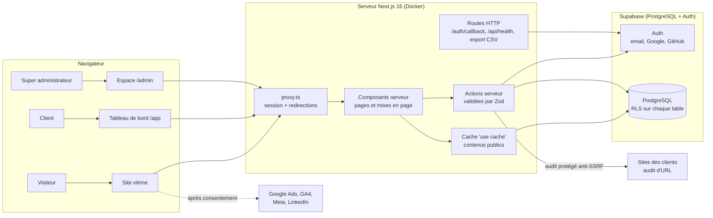
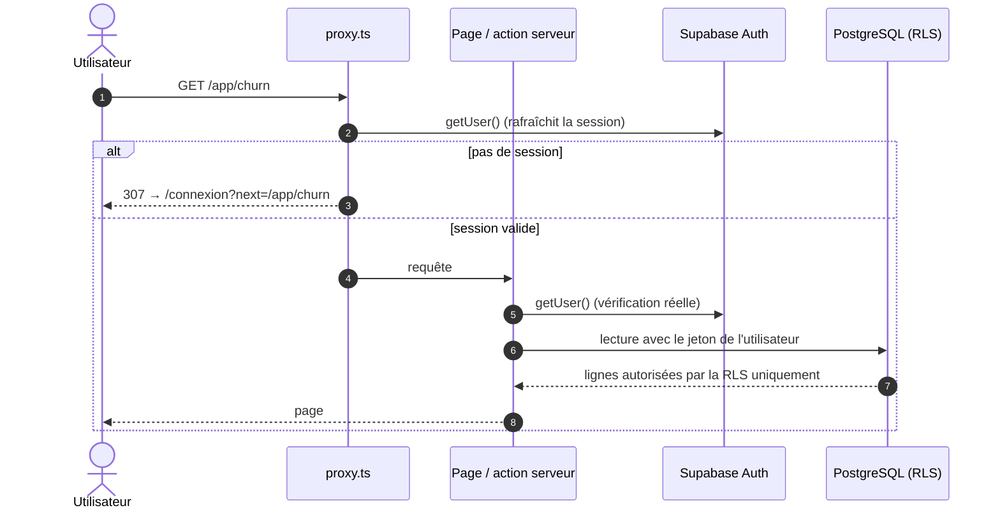

# Architecture de SaasClair

> Vue d'ensemble technique : composants, rendu, frontières client / serveur, authentification,
> cache et déploiement. Les décisions détaillées sont dans `DECISION_LOG.md` (ADR-000 à 020).

## 1. Vue d'ensemble



| Couche | Technologie | Rôle |
|--------|-------------|------|
| Interface | Next.js 16.4 (App Router), React 19.3, Tailwind CSS 4, shadcn/ui (Radix) | Pages, composants accessibles, système de design du brand kit |
| Animations | Motion 14 (`LazyMotion`, `MotionConfig reducedMotion="user"`), CSS | Transformations et opacité uniquement, préférence « réduire les animations » respectée |
| Validation | Zod 4 | Mêmes schémas côté formulaire et côté serveur |
| Données et comptes | Supabase (PostgreSQL 17, Auth, RLS) | Comptes, projets, profils, contenus, journal |
| Tests | Vitest + Testing Library, Playwright + axe-core | 115 tests unitaires, 52 tests de bout en bout |
| Exécution | Docker (image `standalone`), Docker Compose | Développement (`npm run up`) et production identiques |
| Intégration continue | GitHub Actions | Lint, types, tests, audit, build, tests de bout en bout, image Docker, secrets |

## 2. Structure du code

```text
src/
├── app/                      Routes (App Router)
│   ├── (marketing)/          Site vitrine : accueil, À propos
│   ├── (auth)/               Inscription, connexion, mot de passe
│   ├── auth/callback/        Retour Google / GitHub / liens email
│   ├── configuration/        Parcours de configuration en 2 actions
│   ├── app/                  Tableau de bord client (7 écrans)
│   ├── admin/                Espace super administrateur (9 écrans + export CSV)
│   ├── api/health/           Sonde de santé
│   └── design/               Vitrine du système de design (non indexée)
├── components/
│   ├── ui/                   Primitives (boutons, cartes, onglets, panneaux…)
│   ├── brand/                Logo (fichiers fournis), icônes animées
│   ├── data/                 Compteurs, mini-courbes, barres, jauges
│   ├── motion/               Apparitions et cascades
│   └── states/               États vide et erreur
├── features/                 Une fonctionnalité = un dossier (UI + actions + données)
│   ├── marketing/  auth/  setup/  dashboard/  admin/  attribution/  site-content/
├── lib/                      Formats, constantes d'animation, clients Supabase, utilitaires
└── proxy.ts                  Session et redirections « optimistes »
supabase/
├── migrations/               Schéma, RLS, index, déclencheurs (versionnés)
├── seed.sql, seed-admin.sql  Données de démonstration locales
└── templates/                Emails d'authentification en français
e2e/                          Tests de bout en bout (Playwright)
scripts/                      Logos, création d'un super administrateur, documentation
docs-site/                    Portail de documentation (HTML et PDF générés)
```

Règle : une fonctionnalité ne lit pas les fichiers internes d'une autre ; les éléments partagés
vivent dans `components/` et `lib/`.

## 3. Stratégie de rendu

| Zone | Rendu | Pourquoi |
|------|-------|----------|
| Site vitrine `/`, `/a-propos` | Prérendu statique + contenus en cache (`"use cache"`, étiquette `contenu-du-site`, 1 h) | Rapide et bien référencé ; rafraîchi immédiatement par `updateTag` quand l'administrateur modifie un contenu |
| Inscription, connexion | Coquille statique, formulaire rendu côté client (lit les paramètres d'adresse) | Affichage immédiat, validation en direct |
| Configuration, tableau de bord, administration | Prérendu partiel : coquille statique + contenu à la requête dans des `Suspense` avec squelettes | Données propres à chaque compte ; squelettes au lieu d'écrans vides |
| Routes HTTP | Dynamiques | Session, export, sonde |

Avec `cacheComponents` (Next.js 16), toute lecture de cookie, de session ou de l'heure se fait
sous un `Suspense`, après `connection()`.

## 4. Frontières client / serveur

- **Serveur uniquement** (`import "server-only"`) : clients Supabase avec session, lectures de
  l'administration, contrôle d'accès, clé de service, audit d'URL.
- **Actions serveur** (`"use server"`) : toutes les écritures. Chacune revalide l'entrée avec
  Zod, vérifie le compte (et le rôle pour l'administration), puis s'appuie sur la RLS.
- **Composants client** (`"use client"`) : interactions (filtres, panneaux, formulaires,
  animations). Aucune clé ni donnée d'un autre compte n'y transite.
- **Constantes partagées** dans des modules simples (jamais exportées depuis un fichier
  `"use client"`, ce qui les transformerait en références client côté serveur).

## 5. Authentification et autorisation



- **Trois couches** : proxy (redirection), contrôle serveur (`getUser`, `requireSuperAdmin`) et
  RLS en base. Une seule suffit à bloquer un accès indu.
- **Rôles** : `profiles.role` (`user`, `super_admin`). Personne ne peut modifier son propre
  profil ; le rôle se donne depuis l'administration ou par `npm run admin:create`.
- **Fournisseurs** : email et mot de passe (8 caractères minimum), Google et GitHub (prêts,
  activés avec les clés OAuth), flux PKCE pour les liens email.

## 6. Données et cache

- **Écritures** : actions serveur → Supabase avec le jeton de l'utilisateur → RLS.
- **Lectures privées** : composants serveur, dédoublonnées par requête (`React.cache`).
- **Lectures publiques** (FAQ, témoignages, À propos, réglages) : fonctions `"use cache"` avec un
  client anonyme sans cookie, invalidées par `updateTag("contenu-du-site")`.
- **Analyses du tableau de bord** : couche de données de démonstration déterministe
  (`features/dashboard/*/data.ts`). Les écrans ne connaissent que ces fonctions : brancher la
  collecte réelle et Stripe ne touchera pas l'interface (ADR-002).

## 7. Sécurité (résumé)

En-têtes stricts (CSP et HSTS en production), RLS sur chaque table, validation Zod partout,
anti-SSRF pour l'audit d'URL, formulaires de compte en POST, export CSV neutralisé, pixels
publicitaires après consentement uniquement. Détail : `docs/security.md`.

## 8. Environnements et déploiement

| Environnement | Lancement | Adresse |
|---------------|-----------|---------|
| Développement | `npm run up` (Supabase local + conteneur Next.js avec rechargement) | http://localhost:3000 |
| Production locale | `npm run up:prod` (même image qu'en production) | http://localhost:3001 |
| Production | Docker Compose sur VPS Hostinger, Nginx + TLS, CI/CD GitHub Actions | à fournir (incrément 9) |

Ports Supabase locaux : 55321 (API), 55322 (base), 55323 (Studio), 55324 (emails de test).
