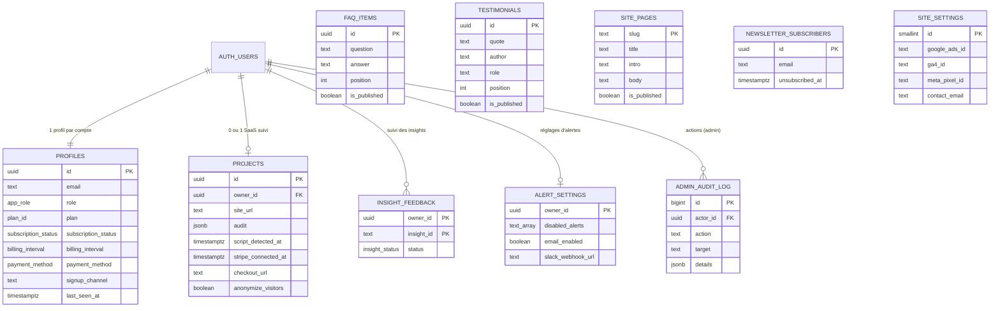

# Modèle de données

> Base PostgreSQL (Supabase). Schéma versionné dans `supabase/migrations/` (4 migrations), RLS
> activée sur **chaque** table. Types TypeScript générés : `npm run db:types`.

## 1. Diagramme entité-relation

## 2. Dictionnaire de données

### `profiles` — compte, rôle, abonnement, provenance
Créé par le déclencheur `on_auth_user_created` à chaque inscription.

| Colonne | Type | Règle |
|---------|------|-------|
| `id` | uuid | = `auth.users.id`, suppression en cascade |
| `role` | `user` \| `super_admin` | Modifiable par un super administrateur uniquement |
| `plan` | `trial` \| `starter` \| `growth` \| `pro` | Prix : 29 €, 79 €, Pro sur devis (`custom_monthly_price`) |
| `billing_interval` | `monthly` \| `annual` | Annuel : −20 % |
| `payment_method` | `card` \| `sepa` \| `paypal` \| `bank_transfer` | Null pendant l'essai |
| `subscription_status` | `trialing` \| `active` \| `past_due` \| `canceled` \| `suspended` | `suspended` ferme le tableau de bord |
| `trial_ends_at` | timestamptz | Inscription + 14 jours |
| `signup_channel` | 8 canaux | `seo`, `ads`, `linkedin`, `instagram`, `partners`, `email`, `referral`, `direct` |
| `signup_source` / `_medium` / `_campaign` / `_referrer` / `_landing` | text bornés | Premier contact (UTM, site d'origine, page d'arrivée) |
| `last_sign_in_at` | timestamptz | Synchronisé depuis `auth.users` |
| `last_seen_at` | timestamptz | Mis à jour au plus une fois par minute ; « connecté » = moins de 5 min |
| `admin_note` | text ≤ 1 000 | Visible des seuls super administrateurs |

### `projects` — SaaS suivi et avancement de la configuration
Un projet par compte. Contrainte : Stripe ne peut pas être connecté avant le script.

### `insight_feedback` — « Fait / Ignorer »
Clé `(owner_id, insight_id)`, statut `done` ou `ignored`.

### `alert_settings` — alertes et canaux
Seules les alertes **désactivées** sont stockées : une nouvelle alerte est active par défaut.
Webhook Slack au format `https://hooks.slack.com/services/…`, jamais renvoyé au navigateur.

### `faq_items`, `testimonials`, `site_pages` — contenus du site
`position` pour l'ordre d'affichage, `is_published` pour la visibilité. `site_pages` n'accepte
que le slug `a-propos`.

### `newsletter_subscribers`
Email unique, en minuscules, au format vérifié. `unsubscribed_at` conserve l'historique.

### `site_settings` — une seule ligne (`id = 1`)
Identifiants publicitaires validés par contrainte (`AW-…`, `G-…`, chiffres) et email de contact.

### `admin_audit_log` — journal
Chaque action d'administration : auteur, action, cible, détails JSON, date.

## 3. Règles d'accès (RLS)

| Table | Visiteur | Client connecté | Super administrateur |
|-------|----------|-----------------|----------------------|
| `profiles` | — | Lit **son** profil | Lit et modifie tout |
| `projects` | — | CRUD sur **son** projet | Lecture de tous |
| `insight_feedback`, `alert_settings` | — | Les **siens** | — |
| `faq_items`, `testimonials`, `site_pages` | Lit les publiés | Lit les publiés | Tout |
| `newsletter_subscribers` | S'inscrit (aucune lecture) | S'inscrit | Lit, modifie, supprime |
| `site_settings` | Lit | Lit | Modifie |
| `admin_audit_log` | — | — | Lit, ajoute (en son nom) |

Fonctions `security definer` (chemin de recherche vide) : `is_super_admin()`,
`touch_last_seen()`, `claim_signup_attribution(…)`, `admin_system_stats()` (réservée au rôle).
Exécution retirée au public et aux visiteurs anonymes.

**Vérifié** avec un second compte (incréments 4, 7 et administration) : isolation des données,
pas d'élévation de rôle (0 ligne modifiée), visiteur sans accès aux profils ni à la newsletter.

## 4. Index et performance

`profiles(created_at desc)`, `profiles(last_seen_at desc)`, `admin_audit_log(created_at desc)`,
clés primaires et contraintes uniques (`projects.owner_id`, `newsletter_subscribers.email`).

## 5. Migrations

| Version | Contenu |
|---------|---------|
| `20261029231227_projects` | Projets, étapes ordonnées, RLS |
| `20261030030336_insight_feedback` | Suivi des insights, page de paiement |
| `20261030150000_alerts_privacy` | Alertes, anonymisation, suppression du projet |
| `20261030200000_super_admin` | Profils et rôles, provenance, abonnements, contenus, newsletter, réglages, journal |

Règle : une migration publiée n'est jamais modifiée ; toute évolution passe par une nouvelle
migration (`npx supabase migration new <nom>`).

## 6. Données de démonstration (local uniquement)

`supabase/seed.sql` (Nadia, son projet) et `supabase/seed-admin.sql` (super administrateur de
démonstration, 60 clients aux domaines réservés `.example`, 28 abonnés, 3 témoignages d'exemple).
Rejouées par `npm run db:reset`.
