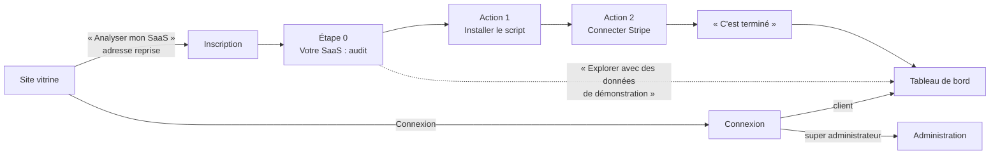

# Parcours, écrans et accessibilité

> Complète `design-system.md` (jetons, composants). Ici : les parcours, l'inventaire des écrans,
> les gabarits, les états et les règles d'accessibilité et d'adaptation aux écrans.

## 1. Parcours principaux



Règle d'or : **deux actions obligatoires seulement**. En cas de doute, l'outil pose une question
fermée, résolue en un clic (ex. : « Est-ce votre page de paiement ? »).

## 2. Inventaire des écrans

| Zone | Écrans |
|------|--------|
| Site vitrine | Accueil (hero avec maquette interactive, 3 promesses, « 2 clics », coût du churn, témoignages, tarifs, FAQ, appel final), À propos |
| Comptes | Inscription, connexion, mot de passe oublié, nouveau mot de passe |
| Configuration | Étape 0, script, Stripe, écran final |
| Tableau de bord | Accueil, Acquisition, Tunnel, Churn et rétention, Revenus, Insights et alertes, Paramètres |
| Administration | Tableau de bord, Utilisateurs, Abonnements, Newsletter, Témoignages, FAQ, À propos, Paramètres, État du système |

## 3. Gabarits

Ordinateur, tableau de bord :

```text
┌────────────┬──────────────────────────────────────────────────┐
│ Logo   [⇤] │ [? Posez une question…]   [30 jours] [🔔3] [N] │
│ Projet     ├──────────────────────────────────────────────────┤
│ ▸ Accueil  │ Titre · résumé en une phrase · ● en direct       │
│   Acquis.  │ [KPI] [KPI] [KPI] [KPI]   ← compteurs animés     │
│   Tunnel   │ Cartes en cascade (insights, graphiques, listes) │
│   Churn    │                                                  │
│   Revenus  │                                                  │
│   Insights │                                                  │
│   Param.   │                                                  │
└────────────┴──────────────────────────────────────────────────┘
```

Mobile (dès 360 px) : barre du haut réduite (logo, question, période, alertes, profil), cartes
empilées, tableaux transformés en listes de cartes, filtres dans un panneau qui glisse du bas,
navigation en bas (Accueil, Acquisition, Tunnel, Churn, Plus).

Administration : barre latérale claire groupée (Clients, Audience, Contenu du site, Réglages),
menu qui glisse depuis la gauche sur mobile et tablette.

## 4. États de chaque écran

| État | Traitement |
|------|------------|
| Chargement | Squelette à la forme de l'écran final, avec brillance (jamais d'écran vide) |
| Vide | Illustration animée + message encourageant + action (ex. « Tout va bien. ») |
| Erreur | Message clair, données rassurées, bouton « Réessayer » (`role="alert"`) |
| Succès | Notification qui glisse et disparaît seule |
| Doute de l'outil | Bandeau avec question fermée et réponses en un clic |

## 5. Mouvement

Transformations et opacité uniquement. Micro-interactions 150 à 250 ms, transitions d'écran
300 à 500 ms, révélations de données 600 à 1 200 ms, cascades de 60 ms. Avec « réduire les
animations », seuls des fondus subsistent (Motion `reducedMotion="user"` et règles CSS).

## 6. Accessibilité (WCAG 2.1 AA)

- **Contrastes** vérifiés par test automatique (émeraude et or réservés aux accents ; variantes
  foncées `emerald-ink` et `gold-ink` pour le texte) et par axe-core sur toutes les pages.
- **Clavier** : tout est atteignable, focus visible (contour émeraude), zones qui défilent
  focusables et nommées, panneaux et fenêtres qui retiennent et rendent le focus.
- **Lecteurs d'écran** : libellés sur les boutons-icônes, tableaux équivalents pour les
  graphiques, compteurs lisibles à leur valeur finale, statuts annoncés (`role="status"`).
- **Cibles tactiles** : 44 px minimum.
- **Formulaires** : étiquettes visibles, erreurs reliées au champ (`aria-describedby`),
  validation en direct bienveillante.

## 7. Langue et ton

Interface entièrement en français, sans couche de traduction (ADR-005). Ton : clair, direct,
rassurant ; le chiffre d'abord, l'action ensuite ; jamais « événements », « propriétés » ni
« segments ». Charte éditoriale complète : `docs/style-guide.md`.

## 8. Adaptation aux écrans

| Largeur | Comportement |
|---------|--------------|
| 360 à 767 px | Navigation en bas, cartes empilées, listes de cartes |
| 768 à 1 023 px | Barre latérale réduite aux icônes |
| 1 024 px et plus | Barre latérale complète et repliable |

Les grilles du tableau de bord utilisent des requêtes de conteneur : elles suivent la largeur
réelle du contenu, qui change quand la barre latérale se replie.
