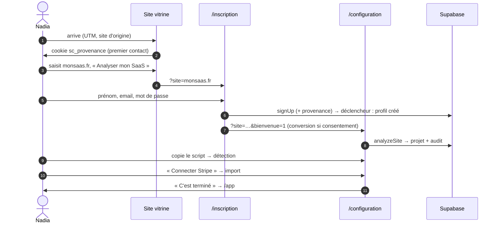
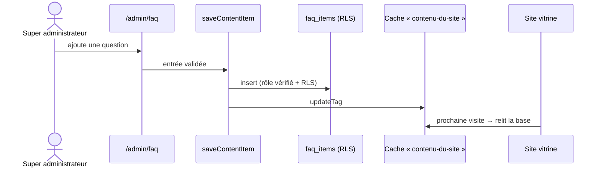

# Conception du système

> Contrats des actions serveur et des routes HTTP, flux principaux, stratégie de cache et de
> pagination. Toutes les entrées sont validées avec Zod, côté formulaire **et** côté serveur.

## 1. Conventions communes

- **Résultat d'une action** : `{ ok: true }` ou `{ ok: false; message }`. Le message est en
  français, clair et rassurant ; il s'affiche dans une notification (toast).
- **Formulaires d'authentification** : `useActionState` → `AuthState`
  (`fieldErrors`, `message`, `status: "error" | "check-email"`), en `method="post"`.
- **Autorisation** : chaque action vérifie la session (`getUser`) ; celles de l'administration
  vérifient le rôle (`superAdminOrNull`) et inscrivent l'action au journal.
- **Rafraîchissement** : `revalidatePath` pour les écrans privés, `updateTag("contenu-du-site")`
  pour le site vitrine.

## 2. Actions serveur

### Comptes — `features/auth/actions.ts`

| Action | Entrée | Contrôles | Effet |
|--------|--------|-----------|-------|
| `signUp` | prénom, email, mot de passe, site (facultatif) | Zod, cookie de provenance | Crée le compte, enregistre la provenance, redirige vers `/configuration?bienvenue=1` |
| `signIn` | email, mot de passe, page demandée | Zod, chemin interne uniquement | Session ; super administrateur → `/admin` |
| `requestPasswordReset` | email | Zod, même réponse que le compte existe ou non | Email de réinitialisation |
| `updatePassword` | nouveau mot de passe | Session de réinitialisation | Mot de passe changé |
| `signOut` | — | — | Fin de session |

### Configuration — `features/setup/actions.ts`

| Action | Entrée | Contrôles | Effet |
|--------|--------|-----------|-------|
| `analyzeSite` | adresse du site | Adresse publique, anti-SSRF, 8 s, 1,5 Mo | Projet créé ou mis à jour avec l'audit |
| `markScriptDetected` | — | Session | Étape 1 validée (simulée) |
| `connectStripe` | — | Session, étape 1 faite (contrainte SQL) | Étape 2 validée (simulée) |

### Tableau de bord — `features/dashboard/**/actions.ts`

| Action | Entrée | Effet |
|--------|--------|-------|
| `setInsightStatus` | id d'insight connu, `done` / `ignored` / `null` | Suivi « Fait / Ignorer » enregistré |
| `confirmCheckoutPage` | chemin ou adresse du même site | Page de paiement confirmée |
| `saveAlertPreferences` | alertes coupées, email actif | Réglages d'alertes |
| `saveSlackWebhook` | adresse `https://hooks.slack.com/services/…` ou `null` | Slack branché ou retiré |
| `setAnonymizeVisitors` | booléen | Anonymisation des visiteurs |
| `deleteProject` | adresse du site retapée | Projet et suivi effacés, retour à la configuration |

### Site public — `features/site-content/newsletter-actions.ts`

| Action | Entrée | Contrôles | Effet |
|--------|--------|-----------|-------|
| `subscribeToNewsletter` | email, source | Zod, piège à robots, doublon traité comme succès | Abonné ajouté |

### Administration — `features/admin/*-actions.ts` (rôle `super_admin` exigé)

| Action | Entrée | Effet (journalisé) |
|--------|--------|--------------------|
| `updateSubscription` | offre, rythme, paiement, statut, prix Pro, note | Abonnement modifié |
| `extendTrial` | id, 7 ou 14 jours | Essai prolongé |
| `setSuperAdmin` | id, booléen (jamais soi-même) | Rôle donné ou retiré |
| `deleteUser` | id, email retapé (jamais soi-même) | Compte supprimé (clé de service, serveur) |
| `saveContentItem` | `faq` ou `testimonial`, id ou `null`, champs | Contenu ajouté ou modifié, site rafraîchi |
| `setContentPublished` / `moveContentItem` / `deleteContentItem` | type, id | Publication, ordre, suppression |
| `saveAboutPage` | titre, introduction, texte, publié | Page À propos |
| `setSubscribed` / `deleteSubscriber` | id | Désinscription, réinscription, effacement |
| `saveSiteSettings` | identifiants publicitaires, email de contact | Réglages du site (formats officiels) |

## 3. Routes HTTP

| Route | Méthode | Accès | Réponse |
|-------|---------|-------|---------|
| `/auth/callback` | GET | Public (code PKCE) | Session créée, provenance posée, redirection interne |
| `/admin/newsletter/export` | GET | Super administrateur | CSV UTF-8 (`;`), formules neutralisées ; 403 sinon |
| `/api/health` | GET | Public | `{ "status": "ok" }` (sonde de déploiement) |

## 4. Flux principaux

### Inscription jusqu'au tableau de bord

### Modification d'un contenu par l'administrateur

## 5. Cache, pagination et limites

| Donnée | Stratégie |
|--------|-----------|
| Contenus publics | `"use cache"` + `cacheLife("hours")` + `updateTag` à chaque modification |
| Session et contexte du tableau de bord | `React.cache` : une seule lecture par requête |
| Contrôle d'accès administrateur | `React.cache` : vérifié une fois par requête |
| Profils (administration) | Jusqu'à 5 000 lus, filtrés côté client, affichés par lots de 40 |
| Abonnés newsletter | Jusqu'à 10 000 lus, affichés par lots de 50 ; export jusqu'à 50 000 |
| « Vu à l'instant » | Au plus une écriture par minute et par utilisateur (`touch_last_seen`) |
| Audit d'URL | 8 s, 1,5 Mo, 3 redirections, ports 80 et 443 |

**Seuil de révision** : au-delà d'environ 5 000 comptes, passer la liste des utilisateurs en
pagination côté serveur (recherche SQL) — noté dans `docs/tech-debt.md`.

## 6. Gestion des erreurs

- **Écran** : chaque zone a un `error.tsx` (message clair, « Réessayer »), un squelette de
  chargement et un état vide.
- **Action** : jamais d'exception brute vers l'interface ; un message utile, l'état précédent
  restauré (interface optimiste annulée).
- **Accès refusé** : redirection (pages) ou 403 (routes).
